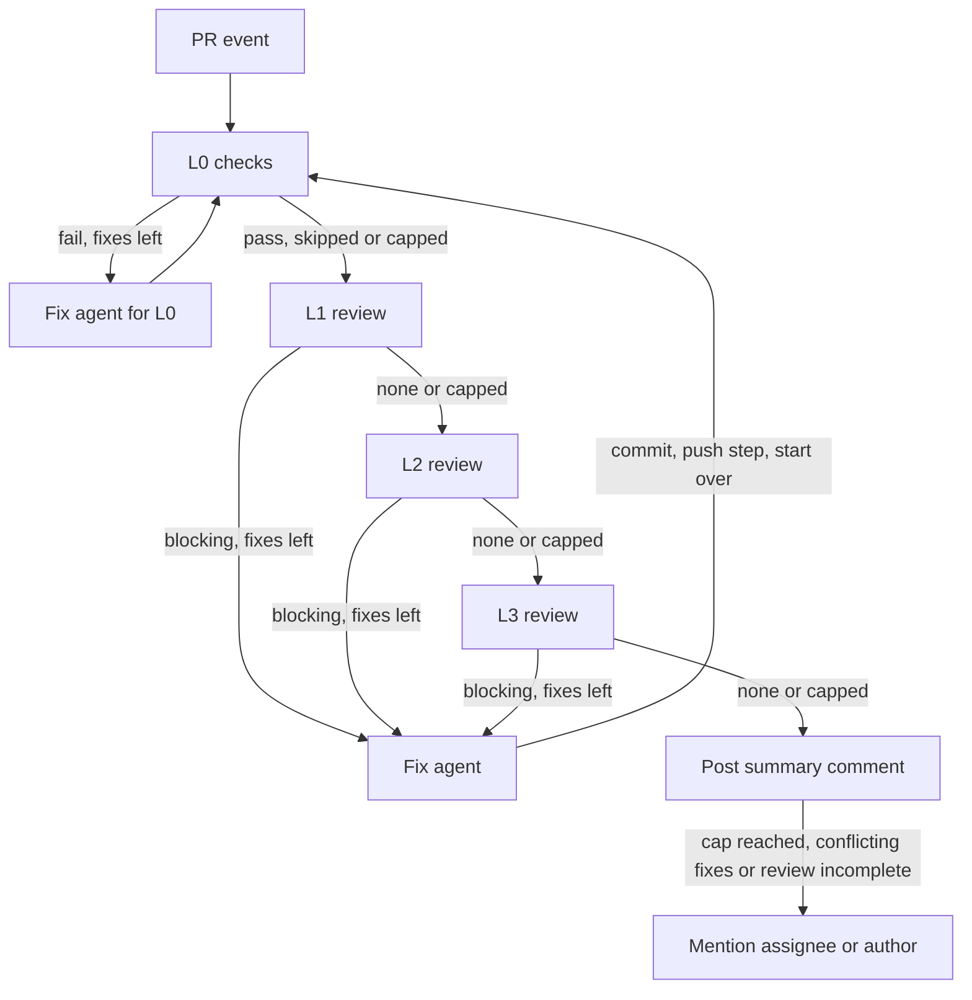

# oneable-dev/.github

Organization-wide reusable GitHub Actions workflows.

| Workflow | Purpose |
| --- | --- |
| [`claude-review.yml`](#claude-review) | Layered pull request review (L0 to L3) with an automatic fix loop. |
| [`claude-mention.yml`](#claude-mention) | Answers `@claude` mentions on issues and pull requests. |

Both use [Claude Code](https://github.com/anthropics/claude-code-action) with a Claude
subscription OAuth token, and both need the
[Claude GitHub App](#install-the-claude-github-app) installed on the repository (or the
organization). The workflows pass no `github_token` to the action, so each agent step
exchanges the job's OIDC token for a short-lived App token and acts as `claude[bot]`.
That is why the caller must grant `id-token: write`. Everything Claude writes is in
English.

## Claude Review

`.github/workflows/claude-review.yml` reviews a pull request in four layers, fixes what
it can, and posts inline comments plus a summary comment. It follows the target
repository's `CLAUDE.md`, `AGENTS.md`, and `ARCHITECTURE*.md`.

What decides each step is code (`.github/claude-review/driver.mjs`), not the model. The
workflow only repeats "driver step, then run the agent if the driver asked for one".

### Layers

| Layer | Who runs it | What it checks | When a finding is blocking |
| --- | --- | --- | --- |
| L0 Checks | The caller's commands, run by the driver | Lint, format, type, and test results from real exit codes | A command fails or times out |
| L1 Requirements and correctness | Opus reviewer | Acceptance criteria from the PR description and linked issues; bugs; regressions | An `unmet` criterion, or a bug or regression with evidence in the code. A criterion that cannot be judged is `unknown` and is never blocking |
| L2 Security | Opus reviewer | Injection, access control, secret exposure, unsafe input, supply chain, CI exposure | A vulnerability with a realistic `attack_path` (attacker, entry point, steps, impact). Without an attack path it is lowered to non-blocking |
| L3 Architecture | Opus reviewer | The base branch's documented rules, and clear structural defects | A broken documented rule, or a clear structural defect. The reviewer decides this itself, and must give the code location (file and line) to change; without one the finding is lowered to non-blocking |

The pipeline checks these rules itself and lowers any blocking finding that does not meet
them. Style, formatting, and naming are non-blocking. If the PR itself edits a rule
document, L3 raises no blocking finding that depends on it and asks a person to confirm
the change.

### Loop



- A cycle runs L0, L1, L2, L3 and stops at the first layer with a blocking finding. The
  fix agent fixes it, the driver commits locally, a push step puts the commit on the PR
  branch (the driver checks the branch on GitHub afterwards and does not trust the
  step's answer), and the cycle starts again from L0. Layers re-review only what changed
  since their last review, and re-check their earlier findings.
- Fixes are capped at `max_fix_rounds` (default 3) for L0 and for each review layer
  separately. When a layer reaches its cap, fixing stops: the layers after it are
  reviewed once without fixes, and the run ends.
- Fixing also stops early when fixes from different layers keep undoing each other. The
  driver records which files each fix commit changed. When a finding whose fix was claimed
  is reopened after a later fix commit of another review layer (not L0) changed a file
  that its own fix also changed, the finding counts one cross-layer reopen and the next
  fixer is told to keep both fixes. At the second such reopen the layer stops fixing,
  like at the cap, and the layers after it are reviewed once without fixes.
- Fixing also stops, with the remaining layers only reviewed, when `enable_fix` is
  false, when the run was triggered by a bot, or when the job time or agent step budget
  is nearly used up (a fix is started only with 35 minutes and 5 agent steps left, so
  its push and a re-review still fit).
- When the run ends with an unresolved blocking finding, failing L0 checks, a layer
  without a complete review, a rejected push, a reached cap, fixes from different layers
  undoing each other, or a driver that stopped on an error, the summary mentions the PR's
  first assignee, or the PR author when nobody is assigned.
- L0 runs the caller's `check_commands` (after `setup_command`, once). If a check fails
  and `fix_command` is set, the driver runs it first and commits what it changed (at
  most three times per run); the L0 fix agent only sees what is left.
  Every reviewer gets the result of every command (exit code, end of output) at the
  commit it reviews, and is told when the checks did not run at that commit.
- The fix agent also gets the blocking findings that other layers had fixed earlier in
  this run (with their commits and diffs), the latest acceptance criteria and the
  requirements. It is told to keep them, to find a change that satisfies both, and to
  report a conflict (`conflict with <id>`) instead of undoing a fix. Reviewers see the
  same fixes (without diffs) so their fix hints do not ask for a revert.
- A review that fails twice on the same commit is reported as incomplete, never as a
  pass.

Behavior:

- Runs on `opened`, `reopened`, `ready_for_review`, and `synchronize`.
- Skips draft PRs, fork PRs (no secrets), and any event other than `pull_request`.
- Skips runs whose triggering actor is `claude[bot]`. Those are pushes the loop made
  itself (see the trust model). The job-level condition keeps them from starting a new
  review loop, and a skipped run does not cancel a run that is still in progress
  (confirmed in a live test).
- Other bot-triggered runs (for example a Dependabot push) are review only: no checks,
  no fixes.
- Fix agents have no shell. The fixer hook denies their edits to `.github/**`, `.claude`,
  `CLAUDE.md`, `.mcp.json`, `.gitmodules`, and `.husky`. If an edit gets through anyway,
  the driver reverts only `.github/workflows` and the restored config paths (`.claude`,
  `.mcp.json`, `.claude.json`, `.gitmodules`, `.ripgreprc`, `CLAUDE.md`,
  `CLAUDE.local.md`, `.husky`) and never stages them. Any other `.github/**` edit is
  stopped by the fixer hook alone. Fix
  commits are pushed to the PR branch by a push-only step as `claude[bot]`, never as a
  force-push. The commits themselves are authored by `github-actions[bot]`.
- A pull request that changes the caller workflow file gets no review from the agent
  steps: the Claude GitHub App only issues a token for a workflow file that matches the
  default branch. The driver detects this at the start, skips the L1 to L3 reviews and
  all fixes, still runs the L0 checks, and says so in the summary comment (Notes). A
  merge of the caller change makes the next run work normally.
- One run per PR at a time; a newer push cancels a run still in progress.

### Summary comment

Each run posts one summary comment on the PR. **Do not edit or delete these comments:**
the next incremental review reads them.

- The first line is `## Claude Review`, followed by the result, the scope, the fix
  commits, and one section per layer (L0 to L3) with the acceptance criteria, findings,
  and notes. Long reports are shortened to fit the comment size limit.
- The last lines are hidden markers: `<!-- claude-review:state=... -->`, which carries
  the unresolved blocking findings, and `<!-- claude-review:head=<40-hex sha> -->`, the
  newest commit that every layer has reviewed. The head marker can be omitted when some
  layer did not finish its review and there is no earlier reviewed commit to keep. The
  next run skips that comment and uses the newest earlier summary that carries both
  markers as its base (an incremental review when that head is an ancestor of the new
  head on `synchronize`). When there is no such summary, it does a full review.
- Each unresolved blocking finding that sits on a line of the diff also gets an inline
  comment.

### Incremental reviews

On `synchronize`, the driver reads the newest summary comment that was posted by
`github-actions[bot]`, starts with `## Claude Review`, and carries both markers.

- The review covers `git diff <marker sha> <new head>`, ignoring hunks that came only
  from merging the base branch.
- Unresolved blocking findings from the marker are loaded again and re-checked in the
  next run, even when their code is outside the new range, along with the L1 criteria.
- A layer whose review did not complete keeps the marker at its last completed commit,
  so the next run reviews what it missed.
- A run that is cancelled by a newer push posts no summary, so its changes are included
  in the next run. A run that fails or stops early still posts one.
- The review is a full one when there is no usable marker, the marked commit is gone or
  is not an ancestor of the new head (force-push or rebase), or the marker equals the
  current head.
- For a full review the reviewers read `git diff <base>...<head>` first and fall back to
  `gh pr diff` when that fails (for example on a very large PR).

### Caller template

Add `.github/workflows/claude-review.yml` to each repository. The check and fix commands
below are examples; use the repository's own.

```yaml
name: Claude Review
on:
  pull_request:
    types: [opened, synchronize, reopened, ready_for_review]
jobs:
  review:
    uses: oneable-dev/.github/.github/workflows/claude-review.yml@main
    permissions:
      contents: read
      pull-requests: write
      issues: write
      id-token: write
    with:
      setup_command: corepack enable && pnpm install --frozen-lockfile
      check_commands: |
        pnpm lint
        pnpm typecheck
        pnpm test
      fix_command: pnpm format
    secrets:
      CLAUDE_CODE_OAUTH_TOKEN: ${{ secrets.CLAUDE_CODE_OAUTH_TOKEN }}
```

A called workflow can never exceed the caller's permissions, so the caller must grant all
four. `contents: read` is enough for the driver (checkout and fetch): fix commits are
pushed with the Claude GitHub App token, not with the job's token. `id-token: write` lets
the agent steps exchange the job's OIDC token for that App token; without it they cannot
authenticate. The commands run on `ubuntu-latest`
after a plain checkout, with no steps of your own before them, so `setup_command` must
install everything the checks need that the runner image lacks. Leave `check_commands`
empty to skip L0 and use review only.

### Inputs

| Input | Type | Default | Description |
| --- | --- | --- | --- |
| `review_model` | string | `claude-opus-5-5` | Model for the L1 to L3 reviewers. |
| `review_effort` | string | `high` | Reasoning effort of the reviewers. Empty omits the flag. |
| `l1_model`, `l2_model`, `l3_model` | string | `""` | Per-layer model. Empty uses `review_model`. |
| `fix_model` | string | `claude-sonnet-5-5` | Model for the fix agent. |
| `fix_effort` | string | `medium` | Reasoning effort of the fix agent. Empty omits the flag. |
| `review_max_turns` | number | `0` | Maximum agent turns per review. `0` uses `max_turns`. |
| `fix_max_turns` | number | `40` | Maximum agent turns per fix. |
| `max_fix_rounds` | number | `3` | Maximum fix rounds for L0 and for each review layer. |
| `timeout_minutes` | number | `120` | Job timeout. The driver also plans its remaining work from it. |
| `agent_step_timeout_minutes` | number | `20` | Timeout of one review or fix agent step. Keep it below 25. The push step has its own 5 minute timeout. |
| `setup_command` | string | `""` | Prepares the checkout (dependencies, tools). Runs once, only when checks run. |
| `check_commands` | string | `""` | Lint, format, type, and test commands, one per line (blank lines and `#` lines are ignored). Each runs with `bash -eo pipefail -c`. Empty skips L0. |
| `fix_command` | string | `""` | Fixes check failures automatically, for example a formatter. Its changes are committed and pushed by the push step. |
| `enable_fix` | boolean | `true` | Let the loop push fix commits. When false, the run only reviews. |
| `extra_prompt` | string | `""` | Repository-specific instructions appended to every agent prompt. |
| `allowed_bots` | string | `"*"` | Bot actors allowed to trigger a review. The action rejects bot actors unless listed. |
| `model`, `max_turns` | string, number | `""`, `30` | Deprecated aliases of `review_model` and `review_max_turns`. A non-empty `model` replaces `review_model`. |

`setup_command`, `check_commands`, `fix_command`, and `extra_prompt` must come from the
caller's own workflow file, never from PR text or other PR content. For `pull_request`
events GitHub uses the PR's version of the caller file, so someone who can open a
same-repository PR can change these values for that PR; this is covered by the trust
model below.

### Secrets

| Secret | Required | Description |
| --- | --- | --- |
| `CLAUDE_CODE_OAUTH_TOKEN` | yes | OAuth token from `claude setup-token`. Must be passed explicitly by the caller. |

### Install the Claude GitHub App

Install the official Claude GitHub App on the organization and grant it the repositories
that use these workflows. Prefer "Only select repositories" over "All repositories". In
`oneable-dev` the App is currently installed for all repositories, and its installation
permissions include write access to contents, pull requests, issues, and workflows.

The action's code lists contents, pull requests, and issues write access as the token
permissions it wants, but when no additional permissions are configured it sends no
request body, so the scope of the issued token is whatever the token service defaults
to. That exact scope has not been verified. Do not assume the token is narrower than the
installation; that is why the controls below do not depend on GitHub rejecting a write.

### Register the secret

1. Run `claude setup-token` in your own terminal and sign in. Copy the token it prints.
2. Register it per repository. `gh` prompts for the value, so paste it yourself:

   ```sh
   gh secret set CLAUDE_CODE_OAUTH_TOKEN --repo oneable-dev/<repo>
   ```

Never commit the token or paste it into a workflow file, issue, or chat.

### Trust model

- L0 runs code from the PR (your setup and check commands, and whatever they execute) on
  the same runner and as the same OS user as the job that holds the OAuth token. The
  commands get a sanitized environment without secrets, but there is no sandbox. So the
  trust boundary is who can open a same-repository PR: people with write access to the
  repository. Fork PRs are excluded, and bot-triggered runs skip L0.
- Token split. Only the agent steps see `CLAUDE_CODE_OAUTH_TOKEN` and the Claude GitHub
  App token. The App token exists only inside an agent step. The action revokes it in a
  best-effort step (`if: always()`, `|| true`) after the agent step, so a failed
  revoke does not fail the job. The driver never holds a write token: it uses `GITHUB_TOKEN` (`contents: read`)
  to fetch, to read the branch with `git ls-remote`, and to post comments. It is fetched
  from this repository at the commit of the called workflow, outside the checkout, so a
  PR cannot replace it.
- Pushes. The only step that pushes is the push step: a Haiku agent with 2 turns and a
  5 minute timeout whose one allowed command is `git push origin HEAD`. It authenticates
  as `claude[bot]` through the App token. After it, the driver reads the branch on GitHub
  and compares it with the fix commit; what the step answered does not matter. A branch
  that does not match stops the loop, and the summary says so. If branch protection blocks
  pushes by `claude[bot]`, fixes are not pushed and the summary says so.
- Tool policy. Every agent step also runs a PreToolUse hook
  (`.github/claude-review/hooks/pretooluse.mjs`), a second layer behind the command line
  tool allowlists. It is fetched from the same commit as the driver and registered per
  step through `--settings`. It resolves real paths (symlinks included), keeps agents out
  of `.git` and the protected configuration (`.github/**`, `.claude`, `CLAUDE.md`,
  `.mcp.json`, `.gitmodules`, `.husky`, and similar), and allows these roles only:

  | Role | Allowed |
  | --- | --- |
  | `review` | Read, Grep, Glob, `git diff/log/show/status`, `gh pr view/diff`, and `StructuredOutput` for the result. No writes. |
  | `fix` | Read, Grep, Glob, and Edit/MultiEdit/Write inside the checkout, outside the input directory and the protected paths. No shell. |
  | `push` | Exactly `git push origin HEAD`. Nothing else. |
  | `mention` | Reads, read-only git, file edits (same path rules, plus CODEOWNERS), `git add/rm/commit` with checked paths, the action's push wrapper for the current branch (never a branch named `main` or `master`), the tracking-comment tool, `ToolSearch` (loads tool schemas only), the read-only CI MCP tools (`get_ci_status`, `get_workflow_run_details`), and the file-ops MCP tools (`commit_files`, `delete_files`) with the same path checks. The file-ops tools only exist with `use_commit_signing`, which the Mention workflow does not enable. |
  | `mention-ro` | Reads, read-only git, the tracking-comment tool, `ToolSearch`, and the read-only CI MCP tools. |

  Grep accepts no `glob` argument. ripgrep gives a later whitelist glob priority over the
  `!.git` exclusion, so a glob such as `*.git` would re-include `.git/config`, where
  checkout credentials can be stored. Matching such patterns is whack-a-mole, so Grep
  keeps `path` and `type` only.
- Denied calls. After each agent step the driver logs how many tool calls the hook denied,
  then lists up to 5 of them in the job log (`denied <rule>: <tool> <target>`, plus a count
  of the rest), so a model that keeps running into the policy can be spotted. The target is
  taken from the hook log, which can hold pull request text, and the job log is public, so
  each line is sanitized first: control characters (newlines included) are replaced by
  spaces, GitHub tokens, `x-access-token` URLs and long base64-like runs become `***`,
  invisible characters (zero-width, bidi, and every default-ignorable code point such as
  U+034F and the variation selectors) are removed first so they cannot split a token, `::`
  and `##[` are split so the text cannot form a workflow command in either syntax, and the
  line is cut at 200 characters. Any configured secret value is redacted too, before and
  after sanitizing. Limit: a token deliberately split by visible characters (a dot, a space)
  is not detected. The masking is a best-effort backstop to the hook and to credential
  scrubbing, not a guarantee.
- The hook cannot be switched off by the repository. A workspace `.claude/settings.json`
  with `disableAllHooks: true` is overridden by the `disableAllHooks: false` in the
  step's own `--settings` file. The driver also restores the protected paths from the
  base branch before every review and fix step. Before the first agent step, `init` runs the hook
  once per role (review, fix, push) with a call it must deny, and the Mention workflow
  does the same for its role before it starts Claude. If a hook does not deny (fail
  closed), no agent step runs and the summary reports the error.
- Git hooks. The checkout is set to `core.hooksPath=/dev/null` before the push step, so
  `.git/hooks` and `.husky` scripts cannot run during `git push`.
- `.github/workflows` is protected in code, not by GitHub. The App installation's
  permissions include `workflows: write`, so GitHub can accept a push that changes
  workflow files (the scope of the issued token is not verified). Protection therefore
  does not rely on GitHub rejecting it: the driver never
  stages `.github/workflows`, reverts any edit a fix agent made there, and the hook
  denies writes to any `.github` path for the fix and mention roles.
- PR text, comments, and file contents are treated as untrusted data in every prompt.
- Commits pushed by `claude[bot]` do trigger other workflows, so a fix commit starts the
  repository's own CI on the new head like a push by a person. Claude Review itself is
  skipped for these runs by the job condition on `github.triggering_actor`. The running
  job has already reviewed and checked the commit in its loop, and it continues to the
  next cycle. A skipped run does not cancel the run in progress (confirmed in a live
  test).
- Cross-repository calls. The OIDC exchange works from a reusable workflow in this
  repository called by another repository (confirmed in a live test, including several
  exchanges in one job).

### Cost and time

A full cycle can call Opus many times: three review layers per pass, a new pass after
every fix, up to three fix rounds per layer, and up to 60 agent steps (slots) per run.
Each fix is followed by one short push step on Haiku, and it uses a slot too. These
calls count against the subscription behind the OAuth token. The job ends after
`timeout_minutes` (default 120). The driver does not start a review step when less than
25 minutes remain, and does not start a fix when less than 35 minutes or fewer than 5
slots remain, so that its push step and a re-review still fit. A push step (5 minute
timeout) needs 10 minutes and one slot. Unfinished work is reported as incomplete, and a
fix commit that cannot be pushed is reported as not pushed. Lower `max_fix_rounds`,
`review_effort`, or `timeout_minutes`, or set `enable_fix: false`, to spend less.

### Runner requirements

`git` and `gh` must be installed in a system directory (`/usr/bin` or `/usr/local/bin`).
The driver ignores the job `PATH`, which L0 commands can change. `ubuntu-latest` has
both, and Node.js for the driver.

### Turn it off or roll back

- Fixes only: set `enable_fix: false` in the caller.
- Disable one repository's review:

  ```sh
  gh workflow disable "Claude Review" -R oneable-dev/<repo>
  ```

- Remove it permanently: delete the caller `.github/workflows/claude-review.yml`
  in that repository.
- Roll back for every repository: revert the change in this repository's `main`
  branch. Callers use `@main`, so the revert (and any other merge) takes effect on the
  next run in every repository.
- Revoke access: delete the `CLAUDE_CODE_OAUTH_TOKEN` secret and revoke the token
  in your Claude account. To stop `claude[bot]` from acting on a repository, remove the
  repository from the Claude GitHub App installation (or uninstall the App).

### Dependabot

Dependabot-triggered runs read secrets from the repository's Dependabot secrets, not
Actions secrets, and get a read-only `GITHUB_TOKEN` by default. They are bot-triggered,
so the loop only reviews, and it cannot push fixes. Add the secret with
`gh secret set CLAUDE_CODE_OAUTH_TOKEN --app dependabot` if you want those PRs
reviewed, and check that the run can post its comments.

Not verified: whether Dependabot-triggered runs can get `id-token: write` and complete
the OIDC exchange for the Claude GitHub App token. Every agent step needs that token, so
if the exchange fails the layers are reported as incomplete. Test it on one Dependabot
PR before relying on it.

### Notes

- This repository must be public (or have Actions sharing enabled) for private
  repositories in the organization to call the workflow.
- Checkout uses full history so the incremental diff can be computed.
- Re-running a job with "Enable debug logging" (`ACTIONS_STEP_DEBUG`) can expose full
  logs, including the prompts and model output. Avoid it on repositories where that matters.
- `allowed_bots` defaults to `*`, so bots can trigger reviews. Their PR title and body
  are passed to the reviewers as a data file (`requirements.md`, marked untrusted)
  together with any linked issues, rather than in the prompt. They are still a
  prompt-injection surface; reviewers have read-only tools, but to reduce risk set an
  explicit list instead, for example
  `with: { allowed_bots: "dependabot[bot],renovate[bot]" }`, or an empty value to
  reject all bot actors.

## Claude Mention

`.github/workflows/claude-mention.yml` answers `@claude` in issue and PR comments, PR
review comments and reviews, and new issues. Claude replies in a tracking comment. It may
commit and push to the PR branch, or to a new `claude/...` branch for an issue, when the
request explicitly asks for a change; questions and review requests get an answer only.

- Only humans with write access can trigger it. Bot actors are rejected.
- Pull requests from forks are skipped, with a short comment explaining why.
- It uses the Claude GitHub App token (see above): it needs `id-token: write` in the
  caller, and the App must be installed on the repository. Comments, commits, and pushes
  are made by `claude[bot]`, not by `github-actions[bot]`.
- It never touches `.github/**` (workflows included) or CODEOWNERS files, never pushes to
  a branch named `main` or `master` (the hook does not look up the repository's default
  branch name), and never force-pushes. If a request needs such a change, it
  describes the change in its reply. The standing instructions ask for this, and a
  PreToolUse hook enforces it (see the Claude Review trust model). The App installation
  has `workflows: write`, so GitHub could accept such a push (the scope of the issued
  token is not verified). The hook runs in the
  `mention` role, or in the read-only `mention-ro` role when `allow_code_changes` is
  false. A check before Claude starts makes the job fail if the hook does not deny a
  forbidden call.
- Pushes by `claude[bot]` start the repository's own CI like any push. They do not start
  Claude Review: its job condition skips runs triggered by `claude[bot]`.
- A pull request that changes the caller workflow file gets no App token for
  `pull_request_review` and `pull_request_review_comment` events, so a mention there
  fails. `issue_comment` events run the default branch's caller file and keep working.
- One run per issue or PR at a time. A new mention waits for the running one instead of
  cancelling it. If several mentions arrive in quick succession, one may be dropped;
  mention Claude again.
- Running it together with Claude Review on one PR can make one of two concurrent pushes
  fail; mention Claude again to retry.

### Caller template

Add `.github/workflows/claude-mention.yml` to each repository. **The caller must be on
the default branch.** `issue_comment` and `issues` events only run workflow files from
the default branch, so a caller added in a PR does nothing until it is merged.

```yaml
name: Claude Mention
on:
  issue_comment:
    types: [created]
  pull_request_review_comment:
    types: [created]
  pull_request_review:
    types: [submitted]
  issues:
    types: [opened]
jobs:
  mention:
    uses: oneable-dev/.github/.github/workflows/claude-mention.yml@main
    permissions:
      contents: read
      pull-requests: write
      issues: write
      id-token: write
    secrets:
      CLAUDE_CODE_OAUTH_TOKEN: ${{ secrets.CLAUDE_CODE_OAUTH_TOKEN }}
```

The caller must grant all four permissions. `contents: read` is enough because commits
and pushes use the Claude GitHub App token, which the action gets by exchanging the OIDC
token that `id-token: write` allows.

### Inputs

| Input | Type | Default | Description |
| --- | --- | --- | --- |
| `model` | string | `claude-sonnet-5-5` | Model. Empty uses the Claude Code default. |
| `effort` | string | `medium` | Reasoning effort. Empty omits the flag. |
| `max_turns` | number | `30` | Maximum agent turns per run. |
| `timeout_minutes` | number | `30` | Job timeout. |
| `trigger_phrase` | string | `@claude` | Phrase that triggers a run. |
| `extra_prompt` | string | `""` | Repository-specific instructions, from the caller's own workflow file. |
| `allow_code_changes` | boolean | `true` | When false, Claude can only read and answer. |

It uses the same `CLAUDE_CODE_OAUTH_TOKEN` secret as Claude Review (see above).
To turn it off, run `gh workflow disable "Claude Mention" -R oneable-dev/<repo>`, delete
the caller, or set `allow_code_changes: false` to keep answers only.
