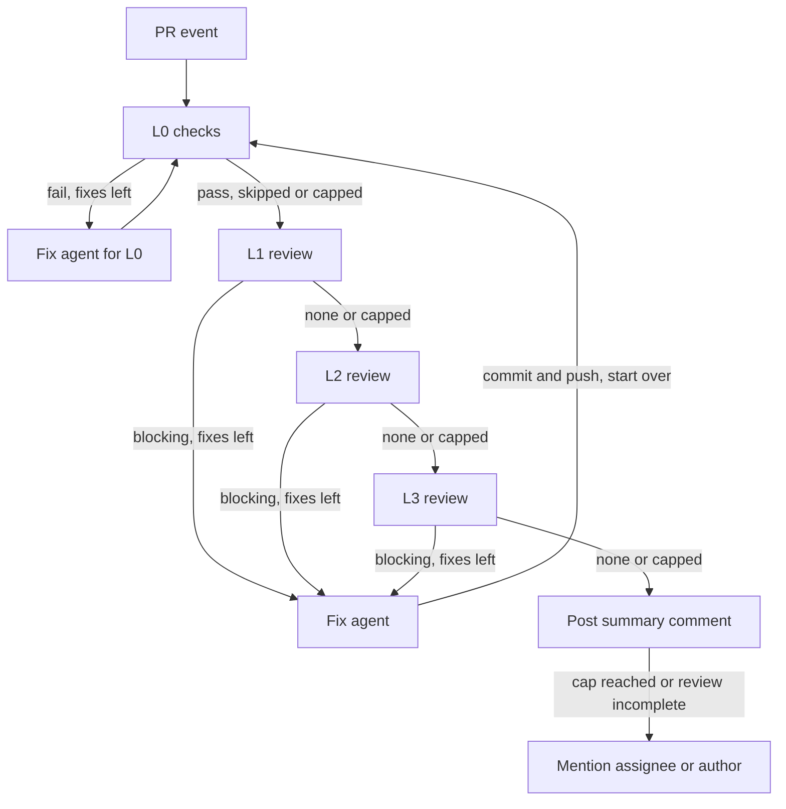

# oneable-dev/.github

Organization-wide reusable GitHub Actions workflows.

| Workflow | Purpose |
| --- | --- |
| [`claude-review.yml`](#claude-review) | Layered pull request review (L0 to L3) with an automatic fix loop. |
| [`claude-mention.yml`](#claude-mention) | Answers `@claude` mentions on issues and pull requests. |

Both use [Claude Code](https://github.com/anthropics/claude-code-action) with a Claude
subscription OAuth token. No Claude GitHub App is required: the workflows pass
`github.token` to the action, which skips the OIDC app-token exchange, so the
`id-token` permission is not needed. Everything Claude writes is in English.

## Claude Review

`.github/workflows/claude-review.yml` reviews a pull request in four layers, fixes what
it can, and posts inline comments plus a summary comment. It follows the target
repository's `CLAUDE.md`, `AGENTS.md`, and `ARCHITECTURE*.md`.

What decides each step is code (`.github/claude-review/driver.mjs`), not the model. The
workflow only repeats "driver step, then run the agent if the driver asked for one".

### Layers

| Layer | Who runs it | What it checks | When a finding is blocking |
| --- | --- | --- | --- |
| L0 Checks | The caller's commands, run by the driver | Lint, format, type, and test results from real exit codes | A command fails or times out |
| L1 Requirements and correctness | Opus reviewer | Acceptance criteria from the PR description and linked issues; bugs; regressions | An `unmet` criterion, or a bug or regression with evidence in the code. A criterion that cannot be judged is `unknown` and is never blocking |
| L2 Security | Opus reviewer | Injection, access control, secret exposure, unsafe input, supply chain, CI exposure | A vulnerability with a realistic `attack_path` (attacker, entry point, steps, impact). Without an attack path it is lowered to non-blocking |
| L3 Architecture | Opus reviewer | The base branch's documented rules, and clear structural defects | A broken documented rule, or a clear structural defect. The reviewer decides this itself, and must give the code location (file and line) to change; without one the finding is lowered to non-blocking |

The pipeline checks these rules itself and lowers any blocking finding that does not meet
them. Style, formatting, and naming are non-blocking. If the PR itself edits a rule
document, L3 raises no blocking finding that depends on it and asks a person to confirm
the change.

### Loop



- A cycle runs L0, L1, L2, L3 and stops at the first layer with a blocking finding. The
  fix agent fixes it, the driver commits and pushes, and the cycle starts again from L0.
  Layers re-review only what changed since their last review, and re-check their
  earlier findings.
- Fixes are capped at `max_fix_rounds` (default 3) for L0 and for each review layer
  separately. When a layer reaches its cap, fixing stops: the layers after it are
  reviewed once without fixes, and the run ends.
- Fixing also stops, with the remaining layers only reviewed, when `enable_fix` is
  false, when the run was triggered by a bot, or when the job time or agent step budget
  is nearly used up.
- When the run ends with an unresolved blocking finding, failing L0 checks, a layer
  without a complete review, a rejected push, a reached cap, or a driver that stopped on
  an error, the summary mentions the PR's first assignee, or the PR author when nobody is
  assigned.
- L0 runs the caller's `check_commands` (after `setup_command`, once). If a check fails
  and `fix_command` is set, the driver runs it first and commits what it changed (at
  most three times per run); the L0 fix agent only sees what is left.
- A review that fails twice on the same commit is reported as incomplete, never as a
  pass.

Behavior:

- Runs on `opened`, `reopened`, `ready_for_review`, and `synchronize`.
- Skips draft PRs, fork PRs (no secrets), and any event other than `pull_request`.
- Bot-triggered runs (for example a bot push) are review only: no checks, no fixes.
- Fix agents have no shell. They cannot touch `.github/workflows/**`, `.claude`,
  `CLAUDE.md`, `.mcp.json`, `.gitmodules`, or `.husky`; the driver reverts such edits.
  Fix commits are pushed to the PR branch as `github-actions[bot]`, never as a force-push.
- One run per PR at a time; a newer push cancels a run still in progress.

### Summary comment

Each run posts one summary comment on the PR. **Do not edit or delete these comments:**
the next incremental review reads them.

- The first line is `## Claude Review`, followed by the result, the scope, the fix
  commits, and one section per layer (L0 to L3) with the acceptance criteria, findings,
  and notes. Long reports are shortened to fit the comment size limit.
- The last lines are hidden markers: `<!-- claude-review:state=... -->`, which carries
  the unresolved blocking findings, and `<!-- claude-review:head=<40-hex sha> -->`, the
  newest commit that every layer has reviewed. The head marker can be omitted when some
  layer did not finish its review and there is no earlier reviewed commit to keep. The
  next run skips that comment and uses the newest earlier summary that carries both
  markers as its base (an incremental review when that head is an ancestor of the new
  head on `synchronize`). When there is no such summary, it does a full review.
- Each unresolved blocking finding that sits on a line of the diff also gets an inline
  comment.

### Incremental reviews

On `synchronize`, the driver reads the newest summary comment that was posted by
`github-actions[bot]`, starts with `## Claude Review`, and carries both markers.

- The review covers `git diff <marker sha> <new head>`, ignoring hunks that came only
  from merging the base branch.
- Unresolved blocking findings from the marker are loaded again and re-checked in the
  next run, even when their code is outside the new range, along with the L1 criteria.
- A layer whose review did not complete keeps the marker at its last completed commit,
  so the next run reviews what it missed.
- A run that is cancelled by a newer push posts no summary, so its changes are included
  in the next run. A run that fails or stops early still posts one.
- The review is a full one when there is no usable marker, the marked commit is gone or
  is not an ancestor of the new head (force-push or rebase), or the marker equals the
  current head.
- For a full review the reviewers read `git diff <base>...<head>` first and fall back to
  `gh pr diff` when that fails (for example on a very large PR).

### Caller template

Add `.github/workflows/claude-review.yml` to each repository. The check and fix commands
below are examples; use the repository's own.

```yaml
name: Claude Review
on:
  pull_request:
    types: [opened, synchronize, reopened, ready_for_review]
jobs:
  review:
    uses: oneable-dev/.github/.github/workflows/claude-review.yml@main
    permissions:
      contents: write
      pull-requests: write
      issues: write
    with:
      setup_command: corepack enable && pnpm install --frozen-lockfile
      check_commands: |
        pnpm lint
        pnpm typecheck
        pnpm test
      fix_command: pnpm format
    secrets:
      CLAUDE_CODE_OAUTH_TOKEN: ${{ secrets.CLAUDE_CODE_OAUTH_TOKEN }}
```

A called workflow can never exceed the caller's permissions, so the caller must grant all
three. `contents: write` is for the fix commits. The commands run on `ubuntu-latest`
after a plain checkout, with no steps of your own before them, so `setup_command` must
install everything the checks need that the runner image lacks. Leave `check_commands`
empty to skip L0 and use review only.

### Inputs

| Input | Type | Default | Description |
| --- | --- | --- | --- |
| `review_model` | string | `claude-opus-5-5` | Model for the L1 to L3 reviewers. |
| `review_effort` | string | `high` | Reasoning effort of the reviewers. Empty omits the flag. |
| `l1_model`, `l2_model`, `l3_model` | string | `""` | Per-layer model. Empty uses `review_model`. |
| `fix_model` | string | `claude-sonnet-5-5` | Model for the fix agent. |
| `fix_effort` | string | `medium` | Reasoning effort of the fix agent. Empty omits the flag. |
| `review_max_turns` | number | `0` | Maximum agent turns per review. `0` uses `max_turns`. |
| `fix_max_turns` | number | `40` | Maximum agent turns per fix. |
| `max_fix_rounds` | number | `3` | Maximum fix rounds for L0 and for each review layer. |
| `timeout_minutes` | number | `120` | Job timeout. The driver also plans its remaining work from it. |
| `agent_step_timeout_minutes` | number | `20` | Timeout of one agent step. Keep it below 25. |
| `setup_command` | string | `""` | Prepares the checkout (dependencies, tools). Runs once, only when checks run. |
| `check_commands` | string | `""` | Lint, format, type, and test commands, one per line (blank lines and `#` lines are ignored). Each runs with `bash -eo pipefail -c`. Empty skips L0. |
| `fix_command` | string | `""` | Fixes check failures automatically, for example a formatter. Its changes are committed and pushed. |
| `enable_fix` | boolean | `true` | Let the loop push fix commits. When false, the run only reviews. |
| `extra_prompt` | string | `""` | Repository-specific instructions appended to every agent prompt. |
| `allowed_bots` | string | `"*"` | Bot actors allowed to trigger a review. The action rejects bot actors unless listed. |
| `model`, `max_turns` | string, number | `""`, `30` | Deprecated aliases of `review_model` and `review_max_turns`. A non-empty `model` replaces `review_model`. |

`setup_command`, `check_commands`, `fix_command`, and `extra_prompt` must come from the
caller's own workflow file, never from PR text or other PR content. For `pull_request`
events GitHub uses the PR's version of the caller file, so someone who can open a
same-repository PR can change these values for that PR; this is covered by the trust
model below.

### Secrets

| Secret | Required | Description |
| --- | --- | --- |
| `CLAUDE_CODE_OAUTH_TOKEN` | yes | OAuth token from `claude setup-token`. Must be passed explicitly by the caller. |

### Register the secret

1. Run `claude setup-token` in your own terminal and sign in. Copy the token it prints.
2. Register it per repository. `gh` prompts for the value, so paste it yourself:

   ```sh
   gh secret set CLAUDE_CODE_OAUTH_TOKEN --repo oneable-dev/<repo>
   ```

Never commit the token or paste it into a workflow file, issue, or chat.

### Trust model

- L0 runs code from the PR (your setup and check commands, and whatever they execute) on
  the same runner and as the same OS user as the job that holds the OAuth token. The
  commands get a sanitized environment without secrets, but there is no sandbox. So the
  trust boundary is who can open a same-repository PR: people with write access to the
  repository. Fork PRs are excluded, and bot-triggered runs skip L0.
- Only the agent step sees `CLAUDE_CODE_OAUTH_TOKEN`. Only the driver sees `GITHUB_TOKEN`
  for pushes and comments. The driver is fetched from this repository at the commit of
  the called workflow, outside the checkout, so a PR cannot replace it.
- Reviewers have read-only tools. Fix agents can edit files but have no shell. PR text,
  comments, and file contents are treated as untrusted data in every prompt.
- Commits and pushes made with `GITHUB_TOKEN` do not trigger other workflows. A fix
  commit does not start the repository's own CI on the new head (and does not retrigger
  this review); the loop's L0 is the check for it. If a required status check is missing
  on the new head, push a commit yourself or close and reopen the PR.
- Pushes that touch `.github/workflows/**` are rejected for `GITHUB_TOKEN`, and fix
  agents are told to leave them alone. If branch protection blocks pushes by
  `github-actions[bot]`, fixes are not pushed and the summary says so.

### Cost and time

A full cycle can call Opus many times: three review layers per pass, a new pass after
every fix, up to three fix rounds per layer, and up to 45 agent steps per run. These
calls count against the subscription behind the OAuth token. The job ends after
`timeout_minutes` (default 120); the driver does not start an agent step when less than
25 minutes remain, and reports unfinished work as incomplete. Lower `max_fix_rounds`,
`review_effort`, or `timeout_minutes`, or set `enable_fix: false`, to spend less.

### Runner requirements

`git` and `gh` must be installed in a system directory (`/usr/bin` or `/usr/local/bin`).
The driver ignores the job `PATH`, which L0 commands can change. `ubuntu-latest` has
both, and Node.js for the driver.

### Turn it off or roll back

- Fixes only: set `enable_fix: false` in the caller.
- Disable one repository's review:

  ```sh
  gh workflow disable "Claude Review" -R oneable-dev/<repo>
  ```

- Remove it permanently: delete the caller `.github/workflows/claude-review.yml`
  in that repository.
- Roll back for every repository: revert the change in this repository's `main`
  branch. Callers use `@main`, so the revert (and any other merge) takes effect on the
  next run in every repository.
- Revoke access: delete the `CLAUDE_CODE_OAUTH_TOKEN` secret and revoke the token
  in your Claude account.

### Dependabot

Dependabot-triggered runs read secrets from the repository's Dependabot secrets, not
Actions secrets, and get a read-only `GITHUB_TOKEN` by default. They are bot-triggered,
so the loop only reviews, and it cannot push fixes. Add the secret with
`gh secret set CLAUDE_CODE_OAUTH_TOKEN --app dependabot` if you want those PRs
reviewed, and check that the run can post its comments.

### Notes

- This repository must be public (or have Actions sharing enabled) for private
  repositories in the organization to call the workflow.
- Checkout uses full history so the incremental diff can be computed.
- Re-running a job with "Enable debug logging" (`ACTIONS_STEP_DEBUG`) can expose full
  logs, including the prompts and model output. Avoid it on repositories where that matters.
- `allowed_bots` defaults to `*`, so bots can trigger reviews. Their PR title and body
  are passed to the reviewers as a data file (`requirements.md`, marked untrusted)
  together with any linked issues, rather than in the prompt. They are still a
  prompt-injection surface; reviewers have read-only tools, but to reduce risk set an
  explicit list instead, for example
  `with: { allowed_bots: "dependabot[bot],renovate[bot]" }`, or an empty value to
  reject all bot actors.

## Claude Mention

`.github/workflows/claude-mention.yml` answers `@claude` in issue and PR comments, PR
review comments and reviews, and new issues. Claude replies in a tracking comment. It may
commit and push to the PR branch, or to a new `claude/...` branch for an issue, when the
request explicitly asks for a change; questions and review requests get an answer only.

- Only humans with write access can trigger it. Bot actors are rejected.
- Pull requests from forks are skipped, with a short comment explaining why.
- It never touches `.github/workflows/**` or CODEOWNERS files, never pushes to the
  default branch, and never force-pushes. If a request needs such a change, it describes
  the change in its reply.
- One run per issue or PR at a time. A new mention waits for the running one instead of
  cancelling it. If several mentions arrive in quick succession, one may be dropped;
  mention Claude again.
- Running it together with Claude Review on one PR can make one of two concurrent pushes
  fail; mention Claude again to retry.

### Caller template

Add `.github/workflows/claude-mention.yml` to each repository. **The caller must be on
the default branch.** `issue_comment` and `issues` events only run workflow files from
the default branch, so a caller added in a PR does nothing until it is merged.

```yaml
name: Claude Mention
on:
  issue_comment:
    types: [created]
  pull_request_review_comment:
    types: [created]
  pull_request_review:
    types: [submitted]
  issues:
    types: [opened]
jobs:
  mention:
    uses: oneable-dev/.github/.github/workflows/claude-mention.yml@main
    permissions:
      contents: write
      pull-requests: write
      issues: write
    secrets:
      CLAUDE_CODE_OAUTH_TOKEN: ${{ secrets.CLAUDE_CODE_OAUTH_TOKEN }}
```

### Inputs

| Input | Type | Default | Description |
| --- | --- | --- | --- |
| `model` | string | `claude-sonnet-5-5` | Model. Empty uses the Claude Code default. |
| `effort` | string | `medium` | Reasoning effort. Empty omits the flag. |
| `max_turns` | number | `30` | Maximum agent turns per run. |
| `timeout_minutes` | number | `30` | Job timeout. |
| `trigger_phrase` | string | `@claude` | Phrase that triggers a run. |
| `extra_prompt` | string | `""` | Repository-specific instructions, from the caller's own workflow file. |
| `allow_code_changes` | boolean | `true` | When false, Claude can only read and answer. |

It uses the same `CLAUDE_CODE_OAUTH_TOKEN` secret as Claude Review (see above).
To turn it off, run `gh workflow disable "Claude Mention" -R oneable-dev/<repo>`, delete
the caller, or set `allow_code_changes: false` to keep answers only.
